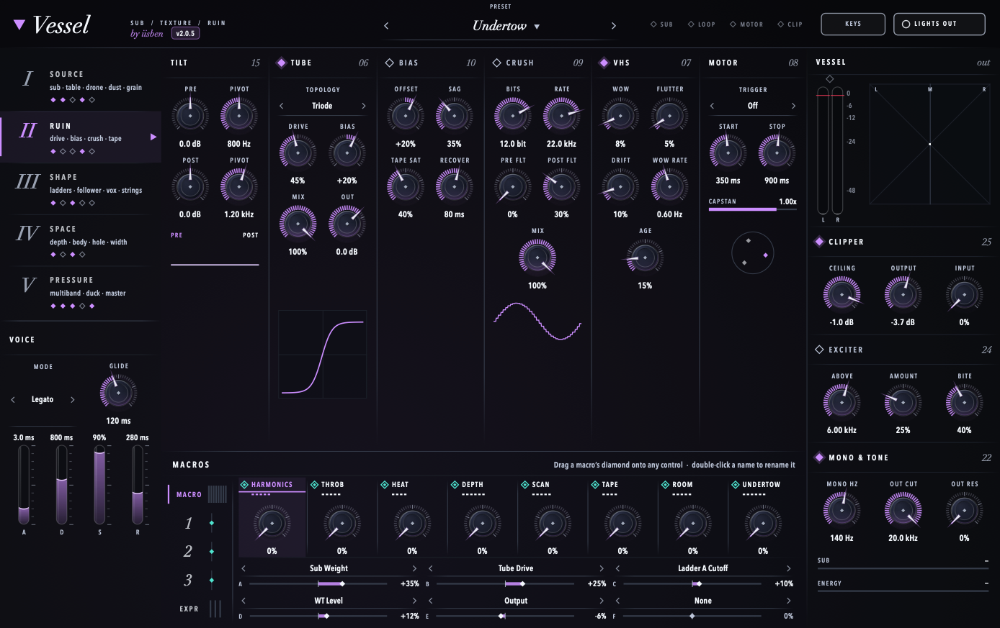
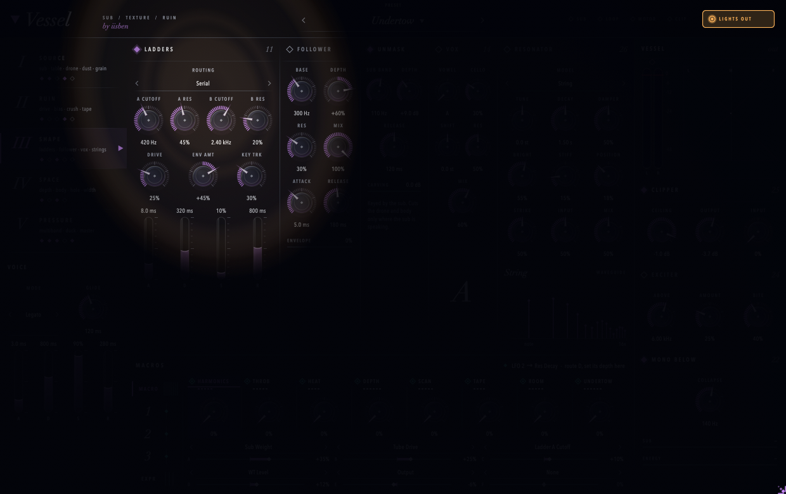
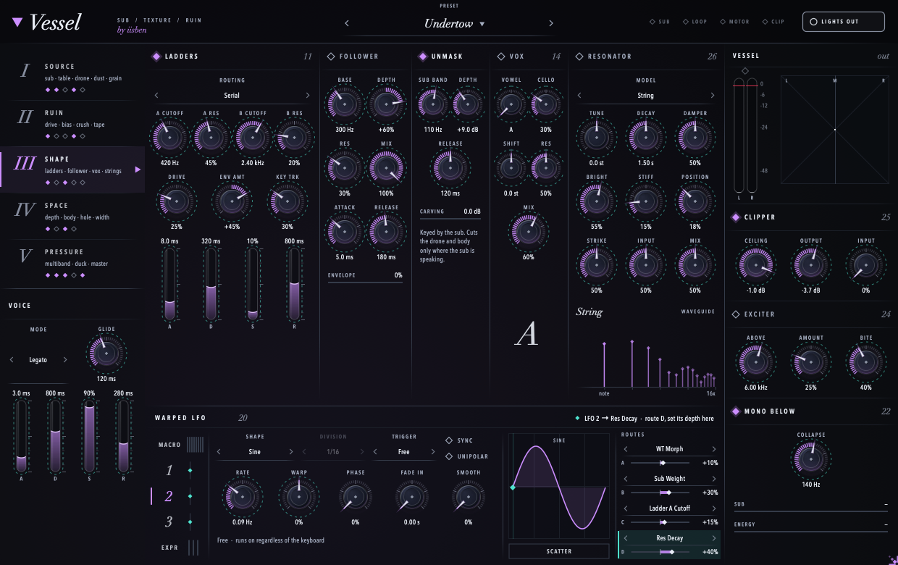

# VESSEL

I am still learning, and I use Copilot to educate and assist me with JUCE. I will not release anything here without many hours of bug checks and testing. I will never charge a dime for anything I make until I have the full capability to build it the long way, from the old world.

VESSEL is a dark synth and effects rack for scores, trailers, IDM and witch house. 


The idea is simple. You start with a clean, phase-locked sub, then drag the sound through five stages (Source,

Ruin, Shape, Space and Pressure) until it's as broken, huge or haunted as you want. It still comes out the other

side mix-ready, with a tight mono low end and no clipping surprises. There are 379 wavetables, an FM operator, a

physical-model resonator, eight macros on every preset, and velocity, mod wheel and aftertouch that actually

change the sound. Have fun fellas and fellets 


 |  


 |  








 |  


 |  


## What's inside


**Sources:** two sub-harmonic generators locked to one phase, so the low end never fights itself. There's a
wavetable oscillator with 379 free tables, a 2-operator FM voice, a slow cinematic drone, dust and vinyl noise,

and a granular looper that can freeze or stutter in time.

**Ruin:** tube drive in three flavours (triode, pentode and a starved, sputtering one), power-supply sag, a bit
crusher, VHS wobble and dropouts, and a tape stop you can play from the keyboard.

**Shape:** two self-oscillating ladder filters, an envelope follower, a filter that carves room for the sub, a
vowel/cello formant, and a physical-model resonator. The resonator can be a string, tube, bell, bar, drum skin,

plate, singing bowl or gong.

**Space:** a tiny delay for front-to-back depth, convolution (built-in rooms or your own IRs), the Black Hole
reverb that can hold forever, and a stereo widener that keeps mono intact.

**Pressure:** 3-band upward and downward compression, mono below a crossover, a ducker keyed by the sub, an
exciter, a clipper and a true-peak ceiling at the end.

**Modulation:** eight named macros, three LFOs with 11 shapes (you can draw your own), and velocity, mod wheel and
aftertouch routes. All 104 parameters can be automated from your DAW.

**No clicks or zipper noise:** every knob is smoothed and every on/off switch crossfades.
**96 factory presets**, all levelled to the same loudness, so A/B-ing presets is honest.


## Installing it (macOS)


Grab the latest build from [Releases](https://github.com/iisben/VESSEL/releases/latest): there's a zip for the

VST3 and one for the AU, both Universal (Apple Silicon and Intel). Unzip them and copy:


`VESSEL.vst3` into `~/Library/Audio/Plug-Ins/VST3/`
`VESSEL.component` into `~/Library/Audio/Plug-Ins/Components/`


## Installing it (Windows)


Download the `Windows-VST3` zip from [Releases](https://github.com/iisben/VESSEL/releases/latest) and copy the whole

`VESSEL.vst3` folder into `C:\Program Files\Common Files\VST3\`. Keep the folder intact, because the wavetables

live inside it. There's also a standalone `VESSEL.exe` in the `Standalone` folder. It isn't code-signed, so

SmartScreen may warn you the first time ("More info", then "Run anyway").


## Expression


Every preset responds to how you play. Velocity, mod wheel and aftertouch each get two routes to any continuous

parameter:


## Macros


Every preset has eight macros, and they're always in the same order, so once you learn the layout it works

everywhere. Each one has a name that fits the sound:


| Macro | Role | Typical routes |


| 1 | Tone (Bloom, Bite, Fury, Snap) | filter cutoffs, tilt, exciter |

| 2 | Motion (Drift, Throb, Unrest, Warble) | speeds up the preset's LFOs, warps them, adds tape wow |

| 3 | Dirt (Heat, Grit, Snarl, Rust) | tube drive and bias, filter drive, crusher, FM feedback |

| 4 | Weight (Depth, Mass, Abyss, Floor) | sub level, drone, a darker tone |

| 5 | Signature (per preset: Choir, Engine, Tine, Skin, Vowel) | whatever makes that sound itself: table morph, vowel, resonator, FM index, grain pitch |

| 6 | Texture (Haze, Ash, Dust, Static) | hiss, crackle, tape age |

| 7 | Space (Arena, Vastness, Distance, Room) | reverb size and mix, depth, width (the low end stays mono) |

| 8 | Transform (per preset: Leviathan, Requiem, Riptide, Afterglow) | a whole scene change across several modules |


Each macro also carries a hidden volume correction, so turning it changes the character, not the level. Macros

are automatable like everything else, so you can draw them in your DAW or map them to a hardware knob.


## The presets


There are 96, all by iisben, in `Presets/FactoryBank.xml`. `PRESETS.md` lists every one with its routing and

measurements.


I wanted each one to stand on its own. Most play a wavetable picked for that sound: big brass under the braams, a

Rhodes under Rotted Tines, a didgeridoo under Buried Giant. Pads and keys keep their sub in check so they leave

room in a mix. Nothing just sits still, and no two presets in a category sound alike.


## Wavetables


Besides its own built-in analog table, VESSEL ships with the 379 **Echo Sound Works Core Tables**, which Echo Sound

Works generously released into the public domain (CC0 1.0). Thank you! They come in 11 categories: Analog, Basics,

Chill, Digital, FM, Growl, Instruments, Metallic, Spectral, One Shots and Vocal.


`tools/make_tables.py <source folder> <repo root>` converts a folder of Serum-format tables into the compressed

`Wavetables/` folder and `Source/dsp/TableList.h`. Switching tables never stalls the audio: the new table loads

in the background while the old one keeps playing.


For the nitty-gritty of the DSP audit and known limits, see `AUDIT.md`.


## Status


VESSEL is built and tested on macOS (Apple Silicon) as a Universal binary. The AU passes Apple's `auval`, the VST3

survives `HostProbe`'s torture tests, all 379 wavetables play, and all 96 presets pass `VesselCheck`. The Windows

VST3 is built on GitHub Actions and passes the same `HostProbe` tests there, but it hasn't been tried in a DAW on

Windows yet. Linux is untested, and none of the builds are code-signed (no Developer ID or notarisation on macOS).

Markdown
# VESSEL

VESSEL is a synthesizer and multi-stage effects plugin built for film scoring, trailers, IDM, and dark electronic production.

Audio flows sequentially through five processing stages—**Source**, **Ruin**, **Shape**, **Space**, and **Pressure**—starting from a phase-locked sub-oscillator and finishing with multiband dynamics, mono low-end summing, and true-peak limiting. The instrument includes 379 wavetables, a 2-operator FM voice, a physical-modeling resonator, eight standardized macros per preset, and per-preset velocity, mod wheel, and aftertouch routing.


| II · Ruin | III · Shape |
|---|---|
|  |  |

| IV · Space | V · Pressure |
|---|---|
|  |  |


| LFO Deck | Expression Deck |
|---|---|
|  |  |

| Preset Browser | Cinematic Category (28 Presets) |
|---|---|
|  |  |

## Architecture & Features

- **Source:** Dual phase-locked sub-harmonic generators for consistent low-end phase alignment, a wavetable oscillator (379 bundled tables plus a built-in analog table), a 2-operator FM voice, a slow drone generator, vinyl/dust noise, and a tempo-synced granular looper with freeze and stutter modes.
- **Ruin:** Three-mode tube saturation (triode, pentode, and starved), power-supply sag, bit crusher, VHS pitch drift and dropouts, and a MIDI-playable tape stop.
- **Shape:** Dual self-oscillating ladder filters, an envelope follower, a sub-unmasking filter, a vowel/cello formant filter, and a physical-modeling resonator with eight models (string, tube, bell, bar, drum skin, plate, singing bowl, and gong).
- **Space:** Short front-to-back depth delay, convolution reverb with built-in room responses and custom IR loading, an infinite-decay reverb (Black Hole), and a mono-compatible stereo widener.
- **Pressure:** 3-band upward/downward compressor, crossover-based mono summing for the low end, a sub-keyed ducker, harmonic exciter, soft/hard clipper, and a true-peak ceiling limiter.
- **Modulation & Automation:** Eight gain-compensated macros, three LFOs with 11 built-in shapes plus custom drawable curves, and two assignable modulation slots each for velocity, mod wheel, and aftertouch. All 104 parameters are exposed for DAW automation.
- **Audio Integrity:** Parameter smoothing on all continuous controls and crossfaded bypass switching to prevent clicks and zipper noise.
- **Factory Library:** 96 loudness-matched factory presets for consistent level comparison when browsing.

## Installation

### macOS

Download the VST3 or AU archive from [Releases](https://github.com/iisben/VESSEL/releases/latest). Both are Universal binaries supporting Apple Silicon and Intel Macs. Extract and copy the bundles to your system or user plugin directories:

- `VESSEL.vst3` → `~/Library/Audio/Plug-Ins/VST3/`
- `VESSEL.component` → `~/Library/Audio/Plug-Ins/Components/`

### Windows

Download the `Windows-VST3` archive from [Releases](https://github.com/iisben/VESSEL/releases/latest) and copy the entire `VESSEL.vst3` folder into `C:\Program Files\Common Files\VST3\`. Keep the directory structure intact so the plugin can locate its bundled wavetables.

A standalone binary (`VESSEL.exe`) is also included in the `Standalone` folder. Because the builds are currently unsigned, Windows SmartScreen may display a warning on first launch (select **More info** → **Run anyway**).

## Macros & Expression

Every preset maps velocity, mod wheel, and aftertouch to up to two continuous parameters each.

All presets also use a standardized eight-macro layout so controls remain predictable across the library. Macro labels adapt to each patch, and every macro includes internal gain compensation to keep output levels consistent while modulating timbre. All macros are DAW-automatable and MIDI-mappable.

| Macro | Role | Typical Destinations |
|---|---|---|
| 1 | **Tone** (Bloom, Bite, Fury, Snap) | Filter cutoffs, tilt EQ, exciter |
| 2 | **Motion** (Drift, Throb, Unrest, Warble) | LFO rates and warp, tape wow |
| 3 | **Dirt** (Heat, Grit, Snarl, Rust) | Tube drive and bias, filter drive, bit crusher, FM feedback |
| 4 | **Weight** (Depth, Mass, Abyss, Floor) | Sub level, drone level, low-pass darkening |
| 5 | **Signature** (Choir, Engine, Tine, Skin, Vowel) | Patch-defining controls: wavetable morph, formant, resonator, FM index, grain pitch |
| 6 | **Texture** (Haze, Ash, Dust, Static) | Noise hiss, crackle, tape wear |
| 7 | **Space** (Arena, Vastness, Distance, Room) | Reverb size and mix, Z-depth, stereo width (low end remains mono) |
| 8 | **Transform** (Leviathan, Requiem, Riptide, Afterglow) | Multi-module scene transitions |

## Factory Presets

VESSEL includes 96 presets created by `iisben`, stored in `Presets/FactoryBank.xml`. Full routing details and loudness measurements for each patch are documented in `PRESETS.md`.

Patches are built around source-specific wavetables (such as brass tables for braams, Rhodes tables for keys, and didgeridoo tables for low drones) with controlled sub levels on pads and keys to sit cleanly in a mix.

## Wavetables

In addition to its built-in analog table, VESSEL bundles the 379 **Echo Sound Works Core Tables** (released under CC0 1.0) across 11 categories: Analog, Basics, Chill, Digital, FM, Growl, Instruments, Metallic, Spectral, One Shots, and Vocal.

Wavetables load in the background while the previous table continues playing, preventing audio dropouts during switching.

To compile custom Serum-format wavetables into the compressed `Wavetables/` directory and regenerate `Source/dsp/TableList.h`, run:

```bash
python tools/make_tables.py <source folder> <repo root>
