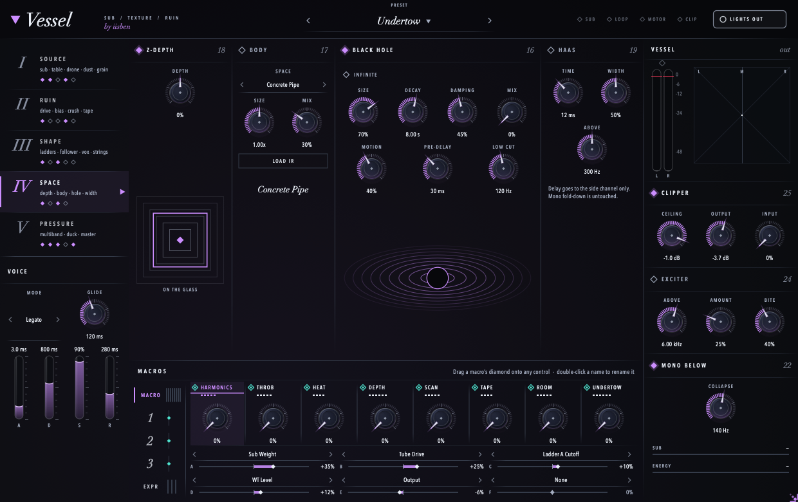

# VESSEL

## What's New in v2.0

- **DSP Engine Upgrade:** Band-limited 3-mip/octave Hermite wavetables, through-zero FM, 64-bit zero-delay-feedback filters, 2nd-order anti-aliased saturation (ADAA2), linear-phase oversampling with host PDC, click-free modulation and envelopes, and 16-voice SIMD optimization.
- **More Sounds & Control:** 20 new flagship presets (116 total), MPE & polyphonic aftertouch support, MIDI Learn, A/B compare, and Undo/Redo.
- **Reactive Backdrop & 3D Knobs:** Transparent obsidian ferrofluid + crystalline plexus OpenGL backdrop that reacts to key presses, sustained holds, and polyphonic touch, paired with subtle 3D sculpted knobs and brighter neon-purple accents.
- **Linux Support:** Native Linux x86_64 VST3 and Standalone builds added alongside macOS Universal and Windows x64.

---

## About VESSEL

VESSEL is a dark 5-stage synthesizer and effects rack built for cinematic scores, trailers, IDM, witch house, and heavy modern bass design.

You start with a phase-locked dual sub, wavetables, FM, drone, noise, and granular textures, then sculpt the signal through five dedicated stages — **Source → Ruin → Shape → Space → Pressure** — ending in a tight mono low end and true-peak ceiling so every patch comes out mix-ready.

---

## Modules & Interface


| II · Ruin (Tilt, Tube, Bias, Crush, VHS, Motor) | III · Shape (Ladders, Follower, Unmask, Vox, Resonator) |
|---|---|
|  |  |

| IV · Space (Depth, Body, Black Hole, Haas) | V · Pressure (Multiband OTT, Ducker) |
|---|---|
|  |  |

| Modulation (LFO & Expression Decks) | Preset Browser (116 Factory Presets) |
|---|---|
|  |  |

---

## Features

- **I · Source:** Phase-locked dual sub oscillators, wavetable engine with 379 bundled CC0 wavetables (Echo Sound Works Core Tables), through-zero 2-op FM, cinematic drone, dust/vinyl noise, and a freeze/stutter granular looper.
- **II · Ruin:** Tilt EQ, 3-topology tube saturation (Triode, Pentode, Starved) with power-supply sag, bit/rate crusher, VHS wow/flutter/dropouts, and a playable tape-stop motor.
- **III · Shape:** Dual self-oscillating 64-bit ZDF filters, envelope follower, sub-carving Unmask filter, vowel/formant shaper, and an 8-mode physical-model resonator (string, tube, bell, bar, drum, plate, bowl, gong).
- **IV · Space:** Front-to-back Z-depth delay, convolution body (built-in rooms + custom IRs), infinite-hold Black Hole reverb, and mono-safe Haas stereo width.
- **V · Pressure & Output:** 3-band upward/downward OTT compression, sub-keyed ducker, mono-below crossover, exciter, soft clipper, and true-peak ceiling.
- **Modulation & Workflow:** 8 named gain-compensated macros per preset, 3 drawable/warped LFOs, drag-and-drop routing, velocity / mod wheel / channel & polyphonic aftertouch / MPE, MIDI Learn, Lights Out mode, and 116 loudness-matched factory presets.

---

## Installation

Download the latest release for your OS from [**GitHub Releases**](https://github.com/iisben/VESSEL/releases/latest).

### macOS (Universal: Apple Silicon + Intel)

Download `VESSEL-2.0.0-macOS-Universal.zip` (or the individual `macOS-VST3` / `macOS-AU` zips), unzip, and copy:

- `VESSEL.vst3` → `~/Library/Audio/Plug-Ins/VST3/`
- `VESSEL.component` → `~/Library/Audio/Plug-Ins/Components/`
- `VESSEL.app` → `/Applications/` or `~/Applications/` (optional Standalone)

> Builds are ad-hoc signed. If macOS Gatekeeper blocks a bundle on first load, run:
> ```bash
> xattr -dr com.apple.quarantine ~/Library/Audio/Plug-Ins/VST3/VESSEL.vst3 ~/Library/Audio/Plug-Ins/Components/VESSEL.component
> ```

### Windows (64-bit)

Download `VESSEL-2.0.0-Windows-x64.zip`, unzip, and copy the **entire** `VESSEL.vst3` folder into:

```text
C:\Program Files\Common Files\VST3\
```

Keep the folder intact (the 379 wavetables live inside it). A standalone `Standalone\VESSEL.exe` is also included — click **More info → Run anyway** if SmartScreen prompts on first launch.

### Linux (x86_64)

Download `VESSEL-2.0.0-Linux-x86_64.tar.gz`, extract, and copy the **entire** `VESSEL.vst3` folder into:

```bash
tar -xzf VESSEL-2.0.0-Linux-x86_64.tar.gz
mkdir -p ~/.vst3
cp -r VESSEL-2.0.0-Linux-x86_64/VESSEL.vst3 ~/.vst3/
```

Keep the folder intact so the bundled wavetables load cleanly, then rescan VST3 plug-ins in your DAW (REAPER, Bitwig, Ardour, Renoise, etc.). A standalone binary is in `Standalone/VESSEL`.

To build natively from source on Ubuntu/Debian:

```bash
./scripts/build_linux.sh --install
```
