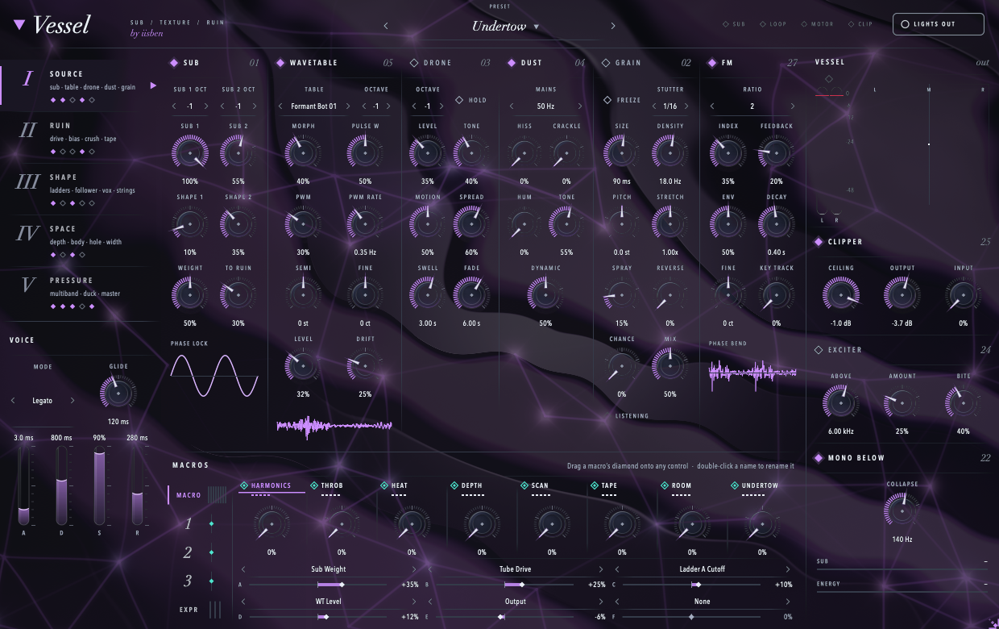
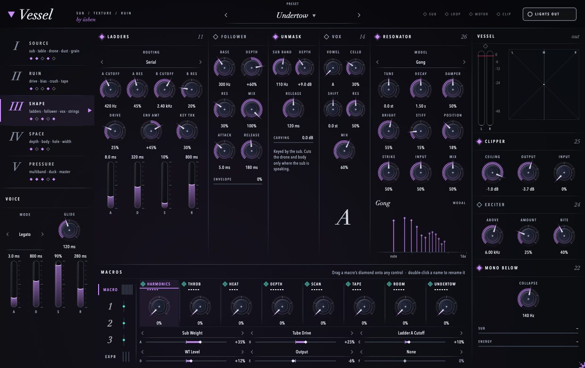
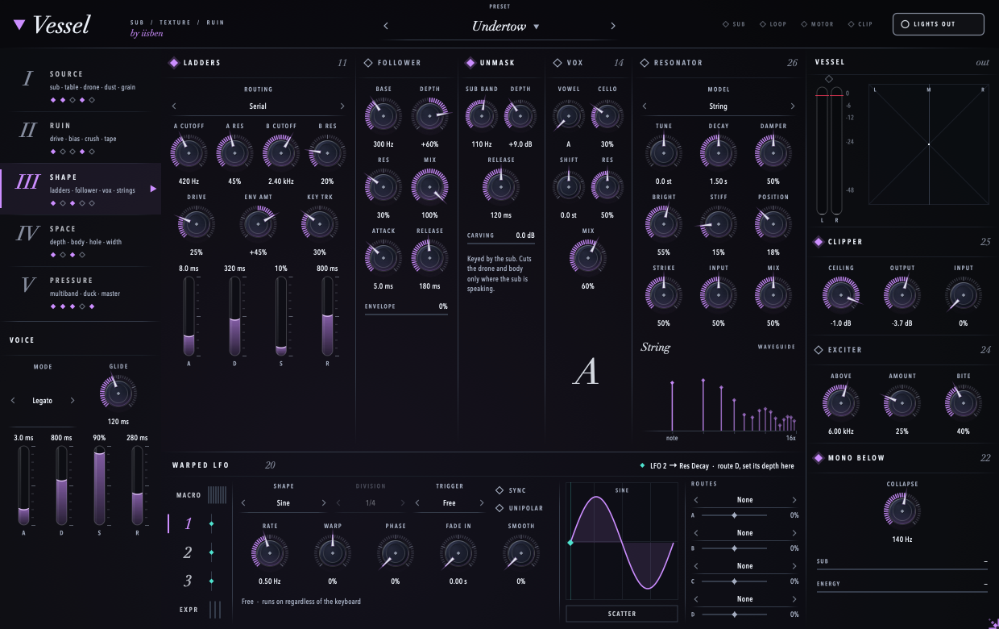
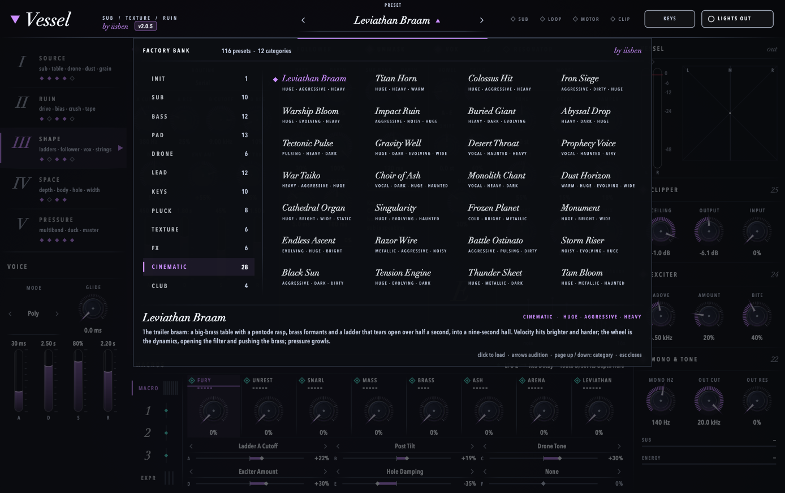

# VESSEL

VESSEL is a dark synth and effects rack for scores, trailers, IDM and witch house: the stuff that rumbles under
a scene, the hit before the title card, the pad that sounds like it's coming through a wall.

The idea is simple. You start with a clean, phase-locked sub, then drag the sound through five stages (Source,
Ruin, Shape, Space and Pressure) until it's as broken, huge or haunted as you want. It still comes out the other
side mix-ready, with a tight mono low end and no clipping surprises. There are 379 wavetables, an FM operator, a
physical-model resonator, eight macros on every preset, and velocity, mod wheel and aftertouch that actually
change the sound.

It runs as VST3, AU or a standalone app on macOS (Apple Silicon and Intel). Built with JUCE 8 by iisben.



| II · Ruin | III · Shape |
|---|---|
|  |  |

| IV · Space | V · Pressure |
|---|---|
|  |  |

## Finding your way around

Everything lives in one window, and it reads in the same order the sound flows. Pick a stage on the left and its
modules fill the middle. The output section (meters, vectorscope, clipper, exciter, mono below) stays on the right
so you can always see what's leaving the plug-in. The deck along the bottom holds the macros, the LFOs and the
expression routes.

A few things worth knowing:

- **Knobs:** drag to turn, double-click to type a value, and Option-click to reset. Right-click shows every
  modulation source, so you can see at a glance what's already wired in.
- **Modulation:** grab an LFO tab, an expression header or a macro's diamond and drop it on any control.
  Everything that can take it lights up with a dashed ring while you drag.
- **Presets:** click the preset name at the top to open the browser: 96 sounds in 11 categories, each with tags and
  a short description. Arrow keys audition, and Page Up / Page Down jump between categories.
- **Size:** drag the little violet sigil in the bottom-right corner.
- **Lights out:** hit LIGHTS OUT at the top right and the room goes dark. Your mouse turns into an old
  flashlight, and you find your way around by its light. It's off by default and remembers your choice per session.


| LFO deck | Expression deck |
|---|---|
|  |  |

| Preset browser | Cinematic (28 presets, four columns) |
|---|---|
|  |  |

## What's inside

- **Sources:** two sub-harmonic generators locked to one phase, so the low end never fights itself. There's a
  wavetable oscillator with 379 free tables, a 2-operator FM voice, a slow cinematic drone, dust and vinyl noise,
  and a granular looper that can freeze or stutter in time.
- **Ruin:** tube drive in three flavours (triode, pentode and a starved, sputtering one), power-supply sag, a bit
  crusher, VHS wobble and dropouts, and a tape stop you can play from the keyboard.
- **Shape:** two self-oscillating ladder filters, an envelope follower, a filter that carves room for the sub, a
  vowel/cello formant, and a physical-model resonator. The resonator can be a string, tube, bell, bar, drum skin,
  plate, singing bowl or gong.
- **Space:** a tiny delay for front-to-back depth, convolution (built-in rooms or your own IRs), the Black Hole
  reverb that can hold forever, and a stereo widener that keeps mono intact.
- **Pressure:** 3-band upward and downward compression, mono below a crossover, a ducker keyed by the sub, an
  exciter, a clipper and a true-peak ceiling at the end.
- **Modulation:** eight named macros, three LFOs with 11 shapes (you can draw your own), and velocity, mod wheel and
  aftertouch routes. All 104 parameters can be automated from your DAW.
- **No clicks or zipper noise:** every knob is smoothed and every on/off switch crossfades.
- **96 factory presets**, all levelled to the same loudness, so A/B-ing presets is honest.

## Installing it (macOS)

Grab the latest build from [Releases](https://github.com/iisben/VESSEL/releases/latest): there's a zip for the
VST3 and one for the AU, both Universal (Apple Silicon and Intel). Unzip them and copy:

- `VESSEL.vst3` into `~/Library/Audio/Plug-Ins/VST3/`
- `VESSEL.component` into `~/Library/Audio/Plug-Ins/Components/`

If you'd rather build it yourself (see below), the same bundles land in `build/Vessel_artefacts/Release/VST3` and `AU`.

Rescan in your DAW and VESSEL should show up as an instrument by **iisben**. The builds aren't notarised yet, so
macOS may block a downloaded copy. This clears the quarantine flag:

```bash
xattr -dr com.apple.quarantine ~/Library/Audio/Plug-Ins/VST3/VESSEL.vst3 ~/Library/Audio/Plug-Ins/Components/VESSEL.component
```

## Installing it (Windows)

Download the `Windows-VST3` zip from [Releases](https://github.com/iisben/VESSEL/releases/latest) and copy the whole
`VESSEL.vst3` folder into `C:\Program Files\Common Files\VST3\`. Keep the folder intact, because the wavetables
live inside it. There's also a standalone `VESSEL.exe` in the `Standalone` folder. It isn't code-signed, so
SmartScreen may warn you the first time ("More info", then "Run anyway").

Every push to `main` also builds the Windows version on GitHub Actions (**Actions → Build (Windows)**). To add it
to a new release, create the release as a draft, run that workflow with the release's tag, then publish. Published
releases can't take new files.

## Building it

You'll need CMake 3.22+ and a C++20 compiler (Xcode 15+ or a recent Clang). It builds against JUCE 8.0.9, and
JUCE 9 works too.

```bash
cmake -B build -DCMAKE_BUILD_TYPE=Release -DCMAKE_OSX_ARCHITECTURES="arm64;x86_64" \
      -DVESSEL_JUCE_PATH="$HOME/Desktop/Meridian Synth/plugin/JUCE"
cmake --build build --config Release -j
```

If you leave out `VESSEL_JUCE_PATH`, CMake downloads JUCE for you. Leave out `CMAKE_OSX_ARCHITECTURES` to build
only for the Mac you're on. Once the AU is installed, `auval -v aumu Vssl Vsla` checks it.

## Testing tools

Configure with `-DVESSEL_BUILD_CHECK=ON` and you get the three tools I use to keep VESSEL honest. They aren't shipped.

| Tool | What it does |
|---|---|
| `VesselLab [all\|zipper\|toggles\|alias\|phase\|lowend\|res\|lfo\|fm\|truepeak\|cpu\|tables]` | Measures the DSP: zipper noise, switch clicks, aliasing per stage, phase, low-end mono safety, resonator tuning and stability, LFO behaviour, FM aliasing, inter-sample peaks and CPU per module. `tables` (about 20 s, not part of `all`) plays every one of the 379 wavetables. |
| `VesselCheck check [outDir] [names]` | Plays every factory preset (or just the ones you name) and fails any that are off target. It checks loudness (−16 LUFS ±1), true peak, clipping with everything maxed out, that velocity, mod wheel and aftertouch really change the tone, that the low end is mono, and that all eight macros are named, do something audible and don't jump in volume. Writes a WAV per preset and the UI screenshots. |
| `VesselCheck ui [outDir]` | Just the UI screenshots, rendered offscreen: the five stages, the decks, the browser, a drag in progress and lights-out mode. `VesselCheck ui docs/images` refreshes the pictures in this README. |
| `VesselCheck calibrate <bank.xml> [names\|category]` | Sets each preset's output gain so it lands on −16 LUFS, and rewrites the file. |
| `VesselCheck audit <bank.xml> <outDir> [names\|category]` | The same checks as `check`, run on a bank file without rebuilding, for work in progress. It adds per-macro numbers and character columns (sub energy, air, width, tail length, peak-to-loudness) and draws a contact sheet of spectrograms. |
| `HostProbe path/to/VESSEL.vst3 ["program"]` | Loads the built VST3 the way a DAW would and puts it through the wringer: scanning, rendering, saving and loading state, programs and the editor. |

## Latency

The drive and output stages run at 4x oversampling, and the true-peak ceiling looks a couple of milliseconds
ahead. All of that adds up to 110 samples at 48 kHz (about 2.3 ms). VESSEL reports it to your DAW, so delay
compensation keeps it lined up with everything else. The number never changes, whatever you switch on or off.
If you're playing live, that's how much extra delay you'll hear in your monitoring.

## Signal flow

```
[4x] voices (sub stack + wavetable → dual ladders) ─┬─ sub bus ─────────────────────────┐
     one shared decimator for body L/R + sub        │                                   │ (fractional delay,
host input ──────────────────────────────────────── body bus ─┐                         │  latency-aligned)
drone + dust ── ducker (keyed by sub) ───────────── texture ──┴─ grain looper → unmask → resonator ─ + sub send
   → pre tilt → [4x: tube → post tilt → bias] → crush → + clean sub → VHS → tape motor
   → follower LPF → formant → Z-depth → convolution → black hole → Haas
   → multiband up/down → mono below → [4x: exciter → output gain → clipper] → true-peak ceiling → sample clamp
```

The resonator sits before Ruin, so the tube can drive it. The clean half of the sub skips Ruin altogether and
rejoins afterwards, delayed by exactly the right amount so the two halves stay in phase.

## Where things live in the code

| # | Feature | Code |
|---|---|---|
| 1 | Dual sub-harmonic generators, one master phase so every zero crossing aligns | `dsp/Voice.h` `Voice::renderBlock` |
| 2 | Granular micro-looper: live grain cloud, freeze, tempo-synced stutter | `dsp/Sources.h` `GranularLooper` |
| 3 | Cinematic drone engine | `dsp/Sources.h` `DroneEngine` |
| 4 | Dust and vinyl noise: hiss, crackle, mains hum, programme-dependent level | `dsp/Sources.h` `NoiseInjector` |
| 5 | Wavetable oscillator: built-in analog table or 379 imported ones (up to 64 frames), band-limited mips, phase-warp PWM, 4x oversampled voices, tables loaded on a background thread | `dsp/Wavetable.*`, `dsp/Tables.*` |
| 6 | Asymmetric tube drive: triode, pentode and bias-starved | `dsp/Ruin.h` `TubeDrive`, `RuinCore` |
| 7 | VHS wow, flutter, drift, oxide loss and dropouts | `dsp/Ruin.h` `VhsTransport` |
| 8 | Tape start/stop on MIDI | `dsp/Ruin.h` `TapeMotor` |
| 9 | Bit crusher and sample-rate reducer | `dsp/Ruin.h` `BitCrusher` |
| 10 | Analog bias: supply sag plus a tape curve with hysteresis | `dsp/Ruin.h` `BiasModulator` |
| 11 | Dual ZDF ladder filters, 24 dB/oct, self-oscillating, SIMD across voices | `dsp/Voice.h` `LadderBank` |
| 12 | Envelope-follower LPF | `dsp/Shape.h` `FollowerFilter` |
| 13 | Spectral unmasking: dynamic EQ keyed by the sub | `dsp/Shape.h` `Unmasker` |
| 14 | Formant filter: A-E-I-O-U morphing toward a cello body | `dsp/Shape.h` `FormantFilter` |
| 15 | Pre/post distortion tilt EQs | `dsp/Common.h` `Tilt` |
| 16 | Black Hole reverb: 8-line FDN with true infinite hold | `dsp/Space.h` `BlackHole` |
| 17 | Convolution with built-in rooms (pipe, TV speaker, stairwell, tank, cassette) or your own IRs | `dsp/Space.h` `ImpulseFactory` |
| 18 | Z-axis micro-delay depth | `dsp/Space.h` `ZAxis` |
| 19 | Mono-safe Haas widener | `dsp/Space.h` `HaasWidener` |
| 20 | Three LFOs: 11 shapes, free / retrigger / one-shot, fade-in, smoothing, 4 destinations each | `dsp/Modulation.h` |
| 21 | 3-band upward/downward compression | `dsp/Pressure.h` `MultibandOtt` |
| 22 | Mono below a frequency, phase-matched | `dsp/Pressure.h` `MonoCollapse` |
| 23 | Sidechain ducker keyed by the sub | `dsp/Pressure.h` `Ducker` |
| 24 | Harmonic exciter, 4x oversampled | `dsp/Pressure.h` `OutputStage` |
| 25 | Clipper, then a look-ahead true-peak ceiling and a final sample clamp | `dsp/Pressure.h` `OutputStage`, `TruePeakCeiling` |
| 26 | Physical-model resonator, 8 voices: string, tube, bell, bar, membrane, plate, bowl, gong | `dsp/Resonator.h` |
| 27 | FM operator with ratio, index, feedback, an index envelope and key tracking; bright tables darken as the index rises instead of aliasing | `dsp/Voice.h` |

## The look

I call the look Reliquary: dark glass over slow ultraviolet ink, drawn by an OpenGL shader
(`ui/Backdrop.cpp`). Knobs are rings of ticks with a thin needle, levels are glass vials, and switches are little
diamonds. The colours mean something: violet is a value or something switched on, green is a live LFO, and red
only ever means clipping. Labels are drawn a touch larger and brighter than you'd expect, so they're easy to read
on the dark background.

On the SOURCE stage the Wavetable column shows the table that's playing, and the FM column draws how the operator
is bending the wave. On SHAPE the resonator shows its overtones, each one as tall as it rings long.

**Lights out.** This one's just for fun. Turn it on and the whole window drops into blue-black darkness, with only
your flashlight to see by. It's meant to look like an old incandescent torch: yellowish light, a faint shadow
from the bulb in the middle, the rings a cheap reflector throws, and a brownish edge where the beam fades out. Aim
it high up the window and the spot stretches and dims, as if you were holding it from below. It lags just behind
your hand and fades as you leave the window. Every control still works in the dark, and the button stays visible
so you can always get the lights back. The code is in `ui/Torch.cpp`.

**Modulation, two ways.** Either drag a source onto any control (it lands at a sensible depth and shows you the new
route), or right-click a control and tick sources on and off from the menu.

The deck at the bottom has five tabs. MACRO shows the eight macros and their routes (double-click a name to rename
it). LFO 1–3 hold each LFO's shape, rate, sync and four routes. EXPR shows velocity, mod wheel and aftertouch with
live meters.

## Expression

Every preset responds to how you play. Velocity, mod wheel and aftertouch each get two routes to any continuous
parameter:

| Source | Parameters | Notes |
|---|---|---|
| Velocity | `vel_dest1/2`, `vel_amt1/2`, `vel_amp` | Routed to a voice parameter, each note uses its own velocity. `vel_amp` sets how much velocity affects loudness. |
| Mod wheel (CC1) | `mw_dest1/2`, `mw_amt1/2` | Smoothed so it never steps. |
| Aftertouch | `at_dest1/2`, `at_amt1/2` | Channel pressure; poly pressure drives the same route. |

An amount of 1 sweeps a parameter across its whole range. Routes can be dragged onto any control, and every slot
can be automated.

## Macros

Every preset has eight macros, and they're always in the same order, so once you learn the layout it works
everywhere. Each one has a name that fits the sound:

| Macro | Role | Typical routes |
|---|---|---|
| 1 | Tone (Bloom, Bite, Fury, Snap) | filter cutoffs, tilt, exciter |
| 2 | Motion (Drift, Throb, Unrest, Warble) | speeds up the preset's LFOs, warps them, adds tape wow |
| 3 | Dirt (Heat, Grit, Snarl, Rust) | tube drive and bias, filter drive, crusher, FM feedback |
| 4 | Weight (Depth, Mass, Abyss, Floor) | sub level, drone, a darker tone |
| 5 | Signature (per preset: Choir, Engine, Tine, Skin, Vowel) | whatever makes that sound itself: table morph, vowel, resonator, FM index, grain pitch |
| 6 | Texture (Haze, Ash, Dust, Static) | hiss, crackle, tape age |
| 7 | Space (Arena, Vastness, Distance, Room) | reverb size and mix, depth, width (the low end stays mono) |
| 8 | Transform (per preset: Leviathan, Requiem, Riptide, Afterglow) | a whole scene change across several modules |

Each macro also carries a hidden volume correction, so turning it changes the character, not the level. Macros
are automatable like everything else, so you can draw them in your DAW or map them to a hardware knob.

## The presets

There are 96, all by iisben, in `Presets/FactoryBank.xml`. `PRESETS.md` lists every one with its routing and
measurements.

I wanted each one to stand on its own. Most play a wavetable picked for that sound: big brass under the braams, a
Rhodes under Rotted Tines, a didgeridoo under Buried Giant. Pads and keys keep their sub in check so they leave
room in a mix. Nothing just sits still, and no two presets in a category sound alike.

**Cinematic** (25) is the heart of the bank. You get braams and low brass (Leviathan Braam, Titan Horn, Warship
Bloom), hits and drops (Colossus Hit, Impact Ruin, War Taiko), low beds (Buried Giant, Gravity Well), choirs and
voices (Choir of Ash, Monolith Chant), wide pads (Dust Horizon, Frozen Planet) and tension builders (Endless
Ascent, Storm Riser, Black Sun). They're set up the way film composers like to work:

- The mod wheel is the dynamics fader. Ride it to open the sound up.
- Velocity shapes the attack, and aftertouch adds growl, breath or bow pressure.
- Soft playing still sounds big, just gentler.
- The reverbs are huge but keep a clean, mono low end, so a 45-second tail won't muddy the mix.

**FM** (5) includes Tine Memory (an electric piano), Feedback Hydra (a snarling wobble), Ion Bell, Orbital Brass
and Tension Engine. **Physical models** include Iron Strings, Drowned Bell, Hollow Reed, Bone Marimba, Skin
Ritual, Cathedral Wire, Thunder Sheet, Temple Bowl and Tam Bloom (play that last one hard for the bloom).

### Editing the bank

The file is a `juce::ValueTree` document, so it's easy to read and edit by hand:

```xml
<VesselPresetBank version="2" author="iisben">
  <Preset name="Undertow" category="Sub" character="Dark|Mono|Heavy" author="iisben" description="...">
    <P id="voice_mode" v="Legato"/>      <!-- choices by name -->
    <P id="flt_a_cut"  v="380"/>         <!-- plain units: Hz, ms, dB, 0..1 -->
    <P id="vel_dest1"  v="flt_a_cut"/>   <!-- modulation destinations by parameter id -->
    <P id="out_gain"   v="-3.4"/>        <!-- set by VesselCheck calibrate -->
  </Preset>
</VesselPresetBank>
```

Anything a preset leaves out takes its default, so presets never carry leftovers from the last sound.

- **Categories:** Init, Sub, Bass, Pad, Drone, Lead, Keys, Pluck, Texture, FX, Cinematic.
- **Character tags** (2 to 4, separated by `|`): Dark, Cold, Warm, Dirty, Clean, Lo-Fi, Tape, Glitch, Evolving,
  Static, Wide, Mono, Aggressive, Soft, Haunted, Metallic, Vocal, Airy, Heavy, Pulsing, Detuned, Noisy, Bright,
  Hollow, Huge, Intimate.

To change the bank: edit the XML, run `VesselCheck calibrate Presets/FactoryBank.xml`, rebuild, then run
`VesselCheck check`. To try ideas without rebuilding, run `calibrate` and `audit` on a copy. One gotcha: new
modulation destinations and wavetables must only ever be added to the end of their lists, because saved
sessions store them by position.

## Wavetables

Besides its own built-in analog table, VESSEL ships with the 379 **Echo Sound Works Core Tables**, which Echo Sound
Works generously released into the public domain (CC0 1.0). Thank you! They come in 11 categories: Analog, Basics,
Chill, Digital, FM, Growl, Instruments, Metallic, Spectral, One Shots and Vocal.

`tools/make_tables.py <source folder> <repo root>` converts a folder of Serum-format tables into the compressed
`Wavetables/` folder and `Source/dsp/TableList.h`. Switching tables never stalls the audio: the new table loads
in the background while the old one keeps playing.

For the nitty-gritty of the DSP audit and known limits, see `AUDIT.md`.

## Status

VESSEL is built and tested on macOS (Apple Silicon) as a Universal binary. The AU passes Apple's `auval`, the VST3
survives `HostProbe`'s torture tests, all 379 wavetables play, and all 96 presets pass `VesselCheck`. The Windows
VST3 is built on GitHub Actions and passes the same `HostProbe` tests there, but it hasn't been tried in a DAW on
Windows yet. Linux is untested, and none of the builds are code-signed (no Developer ID or notarisation on macOS).
