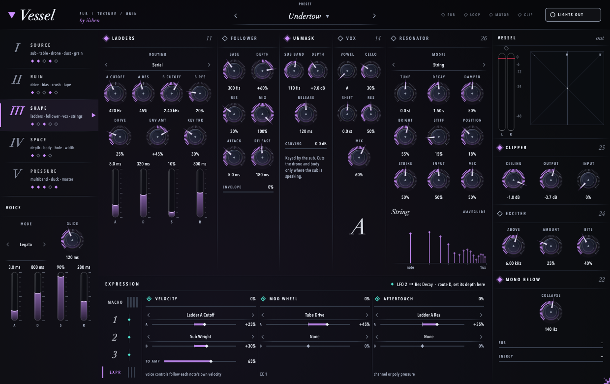

# VESSEL

A dark polyphonic synth and multi-effect for cinematic, IDM and witch house. A phase-locked sub stack,
379 wavetables, an FM operator and a physical-model resonator feed five stages of processing (Source,
Ruin, Shape, Space, Pressure) that take a sound from clean sub to broken tape, black-hole reverb and a
true-peak ceiling. Eight named macros, three warped LFOs and full expression on every preset.

VST3, AU and Standalone on macOS (Universal: Apple Silicon and Intel). Built with JUCE 8, by iisben.


| II · Ruin | III · Shape |
|---|---|
|  |  |

| IV · Space | V · Pressure |
|---|---|
|  |  |

## The interface

One window, read top to bottom like the signal. The five stages are on the left, the selected stage's
modules fill the centre, and the output section (meters, vectorscope, clipper, exciter, mono below) is
always on the right. The modulation deck along the bottom holds the macros, the three LFOs and the
expression routes.

- **Knobs:** drag to turn, double-click to type a value, Option-click to reset. Right-click for every
  modulation source, with a tick and the depth of any existing route.
- **Mapping:** drag an LFO tab, an expression header or a macro's diamond onto any control. Every control
  that can take it shows a dashed ring while you drag; dropping makes the route and brings it forward.
- **Presets:** click the name in the header for the browser: 96 presets in 11 categories, each with
  character tags and a description. Arrow keys audition, Page Up / Page Down change category.
- **Size:** drag the violet sigil in the bottom-right corner.
- **Lights out:** click LIGHTS OUT at the top right and the whole window goes dark; the mouse becomes an
  old incandescent flashlight. Off by default; the choice is saved with the session.


| LFO deck | Expression deck |
|---|---|
|  |  |

| Preset browser | Cinematic (28 presets, four columns) |
|---|---|
|  |  |

## Features

- **Sources:** dual sub-harmonic generators on one master phase, a wavetable oscillator with 379
  imported CC0 tables (band-limited mips, phase-warp PWM, 4x oversampled voices), a 2-op FM operator, a
  cinematic drone, dust and vinyl noise, and a granular micro-looper with freeze and synced stutter.
- **Ruin:** asymmetric tube drive (triode, pentode, bias-starved), analog bias and supply sag, bit
  crusher, VHS wow, flutter and dropouts, and a MIDI-triggered tape start/stop.
- **Shape:** dual self-oscillating ZDF ladders, an envelope-follower LPF, spectral unmasking keyed by the
  sub, a vowel/cello formant filter, and an 8-voice physical-model resonator (string, tube, bell, bar,
  membrane, plate, bowl, gong).
- **Space:** Z-axis micro-delay, convolution with procedural or user IRs, the Black Hole FDN reverb with
  true infinite hold, and a mono-safe Haas widener.
- **Pressure:** 3-band upward/downward compression, mono below a crossover, a sub-keyed ducker, a 4x
  oversampled exciter and clipper, and a look-ahead true-peak ceiling.
- **Modulation:** 8 named, loudness-matched macros with 6 routes each, 3 warped LFOs with 11 shapes
  (including a drawn one), and velocity, mod wheel and aftertouch routes. All 104 parameters are
  host-automatable.
- **Click-free:** every continuous parameter is smoothed and every module switch crossfades over 15 ms.
- **96 factory presets**, each calibrated to −16 LUFS and ≤ −0.5 dBTP and checked by `VesselCheck`.

## Install (macOS)

Build from source (below), then copy the bundles from `build/Vessel_artefacts/Release/`:

- `VST3/VESSEL.vst3` to `~/Library/Audio/Plug-Ins/VST3/`
- `AU/VESSEL.component` to `~/Library/Audio/Plug-Ins/Components/`

Rescan plug-ins in your DAW. VESSEL shows up as an instrument by **iisben**. The bundles are ad-hoc
signed, not notarised, so a copy moved from another Mac may need its quarantine flag cleared:

```bash
xattr -dr com.apple.quarantine ~/Library/Audio/Plug-Ins/VST3/VESSEL.vst3 ~/Library/Audio/Plug-Ins/Components/VESSEL.component
```

## Build

Requires CMake 3.22+ and a C++20 compiler (Xcode 15+ or recent Clang). JUCE 8.0.9 (also targets 9.x).

```bash
cmake -B build -DCMAKE_BUILD_TYPE=Release -DCMAKE_OSX_ARCHITECTURES="arm64;x86_64" \
      -DVESSEL_JUCE_PATH="$HOME/Desktop/Meridian Synth/plugin/JUCE"
cmake --build build --config Release -j
```

Leave out `VESSEL_JUCE_PATH` to download JUCE 8.0.9, and `CMAKE_OSX_ARCHITECTURES` for a native-only build. The plug-ins land in `build/Vessel_artefacts/Release/`.

Validate the AU after installing it to `~/Library/Audio/Plug-Ins/Components`: `auval -v aumu Vssl Vsla`.

## QA tools

Configure with `-DVESSEL_BUILD_CHECK=ON` to build three tools that are not shipped:

| Tool | What it does |
|---|---|
| `VesselLab [all\|zipper\|toggles\|alias\|phase\|lowend\|res\|lfo\|fm\|truepeak\|cpu\|tables]` | Objective DSP measurements: zipper noise in excess of the static patch, bypass clicks (against the same patch held on), inharmonic (alias) energy per stage, dry/wet phase coherence, low-end mono safety, resonator tuning, decay, stability, the bowl's beat and the gong's bloom, LFO movement options, FM aliasing and click-free index sweeps, inter-sample peaks with and without the true-peak ceiling, per-module CPU. `tables` (not part of `all`, about 20 s) decodes and plays all 379 imported wavetables. |
| `VesselCheck check [outDir] [names]` | Renders every factory preset (or only the comma-separated `names`) with a phrase that suits its category. Fails a preset on: integrated loudness off −16 LUFS by more than 1 LU, true peak above −0.5 dBTP, any sample over 0 dBFS with velocity, mod wheel and aftertouch all at maximum, velocity / CC1 / aftertouch changing the timbre by less than 1 dB (the largest of three distances on the level-normalised 1/3-octave spectrum: its average shape, how far each band swings over the phrase, and how fast it moves from frame to frame), side energy below 120 Hz less than 30 dB under the programme, an unnamed or unrouted macro, any macro changing the timbre by less than 1 dB or the loudness by more than 6 LU, or all eight macros at full plus every expression source at maximum reaching 0 dBFS. Writes a WAV per preset and the UI PNGs. |
| `VesselCheck ui [outDir]` | Only the UI PNGs, rendered offscreen from the editor: the five stages, SOURCE with an imported table and the FM operator on, a mapping drag in progress, the LFO, expression and macro decks, the preset browser, and the torch (aimed at two points); it also times a software repaint of a moving beam. `VesselCheck ui docs/images` refreshes the screenshots in this README. |
| `VesselCheck calibrate <bank.xml> [names\|category]` | Sets each preset's `out_gain` (or only those named, or one category's) so it lands on −16 LUFS (BS.1770-4) and rewrites the file. |
| `VesselCheck audit <bank.xml> <outDir> [names\|category]` | The same gates as `check` on a bank *file*, without a rebuild, for work in progress. Adds the macro columns (`mac-min`, the weakest macro's timbre change; `mac-LU`, the largest loudness change; `mac-SP`, the stress peak) and, per preset, each macro's timbre/loudness change. Adds character columns: `sub` (energy below 100 Hz) and `hf` (above 6 kHz), both relative to the whole; `width` (side over mid above 300 Hz); `tail` (the last second against the loudest); and `PLR` (true peak over loudness). Writes a WAV per preset and `sheet.png`, a labelled contact sheet of spectrograms with level and width traces. |
| `HostProbe path/to/VESSEL.vst3 ["program"]` | Loads the built VST3 the way a host does: scan, instantiate, render with MIDI, state round-trip, programs, editor. With a program name it also prints a render signature for that program (deterministic), for example to A/B a bundle with and without its `Resources/Wavetables`. |

## Latency

The RUIN block (tube, post tilt, bias) and the output stage (exciter, gain, clipper) each run inside a 4x polyphase IIR oversampler, and the true-peak ceiling looks ahead (2.2 ms at 44.1 kHz, 2.1 ms at 48 kHz, 1.5 ms at 96 kHz). Their combined delay is reported to the host (`setLatencySamples`), so hosts with delay compensation keep VESSEL aligned with other tracks. The total is 110 samples at 48 kHz (2.3 ms; it was 9 before the true-peak ceiling). It is the same whether the clipper is on or off, so it never changes under the host. When playing live it adds that much to the monitoring path. The clean half of the sub is delayed by the RUIN block's fractional latency (Hermite interpolation) before it re-joins, so the sent and clean halves of the sub always sum in phase.

## Signal flow

```
[4x] voices (sub stack + wavetable → dual ladders) ─┬─ sub bus ─────────────────────────┐
     one shared decimator for body L/R + sub        │                                   │ (fractional delay,
host input ──────────────────────────────────────── body bus ─┐                         │  latency-aligned)
drone + dust ── ducker (keyed by sub) ───────────── texture ──┴─ grain looper → unmask → resonator ─ + sub send
   → pre tilt → [4x: tube → post tilt → bias] → crush → + clean sub → VHS → tape motor
   → follower LPF → formant → Z-depth → convolution → black hole → Haas
   → multiband up/down → mono below → [4x: exciter → output gain → clipper] → true-peak ceiling → sample clamp
```

The resonator sits before RUIN, so the tube can drive it and the clean sub (which re-joins after RUIN) never passes through it.

Every continuous parameter is smoothed: a 20 ms one-pole in the normalised domain once per 64-sample chunk, then a per-sample linear ramp inside the module. Every module switch crossfades over 15 ms.

## Feature map

| # | Feature | Code |
|---|---|---|
| 1 | Dual sub-harmonic generators, one master phase so every zero crossing aligns | `dsp/Voice.h` `Voice::renderBlock` |
| 2 | Granular micro-looper: live grain cloud, freeze, tempo-synced stutter | `dsp/Sources.h` `GranularLooper` |
| 3 | Cinematic drone engine | `dsp/Sources.h` `DroneEngine` |
| 4 | Dust and vinyl noise: hiss, crackle, mains hum, programme-dependent level | `dsp/Sources.h` `NoiseInjector` |
| 5 | Wavetable oscillator: the built-in 8-frame analog table or any of 379 imported tables (up to 64 frames), each frame band-limited into 11 mips by FFT, mip crossfade, phase-warp PWM, voices 4x oversampled. Tables load on a background thread (preset loads and state restores load synchronously) | `dsp/Wavetable.*`, `dsp/Tables.*` |
| 6 | Asymmetric tube drive: triode, pentode and bias-starved modes (all smooth curves), dry/wet mixed inside the 4x domain | `dsp/Ruin.h` `TubeDrive`, `RuinCore` |
| 7 | VHS wow, flutter, drift, oxide loss and dropouts | `dsp/Ruin.h` `VhsTransport` |
| 8 | Tape start/stop on MIDI: start curve `6u−9u²+4u³` overshoots then lands with zero lag | `dsp/Ruin.h` `TapeMotor` |
| 9 | Bit crusher and sample-rate reducer with pre and post filters | `dsp/Ruin.h` `BitCrusher` |
| 10 | Analog bias modulator: supply sag plus tape curve with hysteresis | `dsp/Ruin.h` `BiasModulator` |
| 11 | Dual ZDF ladder filters, 24 dB/oct, tanh in the loop, self-oscillating; all voices filtered together in SIMD lanes | `dsp/Voice.h` `LadderBank` |
| 12 | Envelope-follower LPF | `dsp/Shape.h` `FollowerFilter` |
| 13 | Spectral unmasking: dynamic EQ keyed by the sub bus | `dsp/Shape.h` `Unmasker` |
| 14 | Formant filter: A-E-I-O-U morph blended toward cello body | `dsp/Shape.h` `FormantFilter` |
| 15 | Pre/post distortion tilt EQs | `dsp/Common.h` `Tilt` |
| 16 | Black Hole reverb: 8-line Hadamard FDN, modulated, true infinite hold | `dsp/Space.h` `BlackHole` |
| 17 | Convolution with procedural IRs (pipe, TV speaker, stairwell, tank, cassette) plus user IRs | `dsp/Space.h` `ImpulseFactory` |
| 18 | Z-axis micro-delay depth | `dsp/Space.h` `ZAxis` |
| 19 | Haas widener, mono-safe (delay injected into the side only) | `dsp/Space.h` `HaasWidener` |
| 20 | 3 warped LFOs: 11 shapes (incl. glitch, drawn, smooth-random wander, pump, stairs), free / retrigger / one-shot, start phase, fade-in, output smoothing, unipolar, 4 destinations each, any continuous parameter | `dsp/Modulation.h` |
| 21 | 3-band upward/downward compression, LR4 with allpass-compensated low band | `dsp/Pressure.h` `MultibandOtt` |
| 22 | M/S collapse below a frequency, phase-matched mid allpass | `dsp/Pressure.h` `MonoCollapse` |
| 23 | Sidechain ducker (follow or pump), keyed by the sub | `dsp/Pressure.h` `Ducker` |
| 24 | Harmonic exciter, 4x oversampled | `dsp/Pressure.h` `OutputStage` |
| 25 | Brickwall clipper, 4x oversampled, then a true-peak ceiling (look-ahead gain from a 16x reconstruction of the waveform, so inter-sample peaks stay under the ceiling) and a sample-exact clamp as a backstop | `dsp/Pressure.h` `OutputStage`, `TruePeakCeiling` |
| 26 | Physical-model resonator, 8 note-following voices: string (Karplus-Strong with dispersion, phase-delay tuned), tube (odd-harmonic closed bore), bell, bar, membrane, plate (12 two-dimensional plate modes weighted by the strike point), bowl (thin-ring modes split into beating doublets) and gong (dense shell modes with an amplitude-driven bloom into the upper modes and tension-modulated pitch). Excited by the synth bus and a per-note strike | `dsp/Resonator.h` |
| 27 | FM operator: a sine modulator per voice that phase-modulates the wavetable oscillator. Ratio from 1/4 to 14 plus fine tune, index (up to 12 rad), DX-style averaged feedback, an index envelope retriggered with the amp envelope, and index key tracking. The oscillator's mip follows the instantaneous frequency the modulation reaches, so a bright table darkens as the index rises instead of folding over | `dsp/Voice.h` |

## UI: Reliquary

A dark-glass instrument over slow ultraviolet ink rendered by an OpenGL shader (`ui/Backdrop.cpp`).
Modules are vertical ranks separated by fading hairlines. Rotary controls are tick halos with a blade needle, levels are glass vials with a liquid meniscus, and switches are diamond runes. Colour is semantic: neon violet = value/active, chlorine = live LFO modulation, blood = clipping only. Type pairs Didot italic with Avenir Next Condensed in tracked caps. Every caption and value under 12.5 pt is drawn one point larger, with tighter tracking so it keeps its width, and the secondary text colour is brighter, so labels read at a glance on the dark glass. The window's resize grip in the bottom-right corner is a violet sigil: a soft wedge of light, two hairline brackets along the edges and three diamonds that grow toward the corner. It brightens under the mouse and turns frost while you drag.

The SOURCE stage has six columns: Sub, Wavetable, Drone, Dust, Grain and FM. The Wavetable column's Table selector opens a menu of the imported tables by category (the arrows step through them), and its display draws the current frame of the table that is playing. The FM column has Ratio, Index, Feedback, Env, Decay, Fine and Key Track, and a Phase Bend display: two cycles of the oscillator as the operator bends it.

The SHAPE stage holds the ladders, the follower, unmask, the formant filter and the resonator. The resonator column has its model selector, nine controls (tune, decay, damper, bright, stiffness, position, strike, input, mix) and a partials display: the current model's overtones on a log-frequency ruler, each one as tall as it rings long.

Double-click any control to type a value. Option-click resets it. Drag in the LFO canvas to draw when the shape is set to Drawn.

**The torch.** With LIGHTS OUT on (the button at the top right, which always stays visible), a layer above every control (`ui/Torch.cpp`) holds the window in cool blue-black darkness and the mouse becomes a hand-held light. The light falls at full brightness on whatever it touches. The beam is an old incandescent torch: a yellowed amber wash with the bulb's faint shadow at its heart, the bright reflector rings of a cheap reflector, a dimmer spill and a brown-amber fringe where it dies. The light is held below the window, so further up the panel the spot stretches into an ellipse along the line from the hand and dims slightly. The beam trails the mouse with a 28 ms lag, fades up when the mouse enters the window and fades out when it leaves. The layer never takes a click, so every control works in the dark. The setting is saved with the session (off by default) and repaints only the area the beam sweeps.

**Mapping modulation.** Two ways, both one gesture:

- Drag an LFO tab (1, 2, 3), an expression header (Velocity, Mod Wheel, Aftertouch on the EXPR tab) or a macro's diamond (on the MACRO tab) onto any control. Every control that can take it shows a dashed chlorine ring while you drag. Dropping routes the source into its first free slot at a moderate depth, brings that source's page forward and highlights the new route so you can set its depth.
- Right-click any control: the menu lists all fourteen sources (macros by their names) with a tick and the depth of any existing route. Click a source to add or remove it. The menu also has Clear modulation, Type a value and Reset to default.

The modulation deck at the bottom has five tabs. MACRO (the default) shows the eight macro knobs with their names and six routes for the selected macro; double-click a name to rename it. LFO 1-3 each show their motion controls (shape, division, trigger, sync, unipolar, rate, warp, phase, fade-in, smooth), the shape with a live playhead, and four routes (destination plus a bipolar depth bar). EXPR shows the three performance sources with live meters, two routes each and velocity-to-amp.

**Presets.** Click the preset name in the header for the browser. It shows categories with counts, the category's presets with their character tags, and the description of the preset under the mouse. Categories with more than 18 presets (Cinematic) use four columns instead of three. Click to load. Arrow keys audition, page up and page down change category, and Esc closes.

## Expression

Every preset routes three performance sources, two destinations each, to any continuous parameter:

| Source | Parameters | Notes |
|---|---|---|
| Velocity | `vel_dest1/2`, `vel_amt1/2`, `vel_amp` | Routed to a voice parameter (sub, wavetable, ladders, envelopes, glide), it is applied per voice from that voice's own note-on velocity. Routed elsewhere, it follows the latest note. `vel_amp` is how much velocity scales loudness. |
| Mod wheel (CC1) | `mw_dest1/2`, `mw_amt1/2` | Smoothed over 12 ms. |
| Aftertouch | `at_dest1/2`, `at_amt1/2` | Channel pressure; polyphonic pressure drives the same bus. |

The offset is amount × source in the normalised range, so an amount of 1 sweeps the whole range once (a unipolar LFO works the same way; a bipolar LFO swings half that either side of the knob). The routes are on the EXPR tab of the modulation deck, they can be dragged onto any control, and every slot is host-automatable.

## Macros

Eight macros, `macro1` to `macro8` (0 to 1), each with six routes (`macN_destK`, `macN_amtK`, K = 1 to 6) to any continuous parameter. They add amount × macro in the normalised range like the expression sources, after expression and before the LFOs, so a macro can speed up or warp an LFO. Each macro has a name of up to 24 characters, saved with the session and loaded from the preset. All 104 parameters are host-automatable, so a macro can be drawn in the host's automation lane or mapped to a hardware knob.

Every factory preset names and maps all eight, in the same order of roles so a player learns the layout once, with names that belong to the sound:

| Macro | Role | Typical routes |
|---|---|---|
| 1 | Tone (Bloom, Bite, Fury, Snap) | ladder cutoffs to a musical target, tilt, exciter |
| 2 | Motion (Drift, Throb, Unrest, Warble) | the preset's own free LFOs sped up into audible movement, synced LFO warp, table drift, tape wow |
| 3 | Dirt (Heat, Grit, Snarl, Rust) | tube drive and bias, ladder drive, crusher depth, FM feedback, multiband squash |
| 4 | Weight (Depth, Mass, Abyss, Floor) | sub level and weight, drone level, a darker tilt, a lower cutoff |
| 5 | Signature (per preset: Choir, Engine, Tine, Skin, Vowel) | the sound's own engine: table morph, formant vowel, resonator strike and decay, FM index, grain pitch |
| 6 | Texture (Haze, Ash, Dust, Static) | hiss, crackle, tape age and flutter |
| 7 | Space (Arena, Vastness, Distance, Room) | reverb mix and decay to a target, damping, Z depth, Haas width (the low end stays mono) |
| 8 | Transform (per preset: Leviathan, Requiem, Riptide, Afterglow) | a scene change from several modules at once |

Routes are written from target values, so a macro at full lands on a musical setting whatever the preset's starting point. The sixth route of a macro is its loudness match: an `out_gain` offset measured for that macro, so turning a macro changes the character, not the volume.

## Factory presets

96 presets in `Presets/FactoryBank.xml`, compiled in as binary data and shown by category in the header's preset browser. The six physical-model presets (Iron Strings, Drowned Bell, Hollow Reed, Bone Marimba, Skin Ritual, Cathedral Wire) follow the original 57, then the 25 Cinematic presets, then eight that show the FM operator, the imported tables and the three newest resonator models, so earlier program numbers never move. All are by iisben. `PRESETS.md` lists every preset with its routing and its measured loudness, peaks and expression depth.

**What every preset has.** The fifth pass measured the bank (spectrum, movement, width, nearest neighbour) and set it against what the best-loved factory banks do: a sound with an identity of its own, built-in movement and effects, room left for the rest of a mix, and macros that each change something you can hear. So:

- **Its own source.** 74 of the 96 presets play an imported table chosen for the sound (big brass under the braams, a Rhodes under Rotted Tines, a didgeridoo under Buried Giant, a solo cello under Battle Ostinato), where a third of the bank used to share the built-in table at its saw frame.
- **Room in a mix.** The default sub stack is cut back on pads, drones, keys, leads, plucks and textures, which had carried about 40 % of their energy below 100 Hz. Anything without air got an exciter, and anything narrow got Haas width above the mono crossover.
- **Movement at rest.** Any sound that stood still has a slow table drift.
- **Eight named macros**, loudness-matched (see Macros).
- **No twins.** Before this pass, 18 presets measured within 4 dB of another in their category (1/3-octave spectral distance plus movement, width and brightness). None does now; the closest pair is 4.1 dB apart. Black Infinity (formerly Event Horizon) keeps its program number.

**Cinematic** (25) is for score and trailer work. It has braams and low brass (Leviathan Braam, Titan Horn, Warship Bloom, Iron Siege), hits and drops (Colossus Hit, Impact Ruin, Abyssal Drop, War Taiko), and low-end beds (Buried Giant, Tectonic Pulse, Gravity Well). It has voices and choirs (Desert Throat, Prophecy Voice, Choir of Ash, Monolith Chant) and wide pads (Dust Horizon, Cathedral Organ, Singularity, Frozen Planet, Monument). For tension it has Endless Ascent (a Shepard-tone riser), Razor Wire, Battle Ostinato, Storm Riser and Black Sun. They share a few conventions:

- The mod wheel is the dynamics lane, as composers ride CC1 on orchestral libraries: it opens, drives or brightens. Velocity shapes the attack, and aftertouch is growl, breath or bow pressure.
- Velocity-to-amp is 0.5, so soft playing stays big rather than just quiet.
- Every large space has a pre-delay and a low cut on the reverb (150 to 300 Hz). Below 140 Hz the sound is mono, so the low end stays tight under tails of up to 45 seconds.
- Size comes from layering (sub, six-partial drone, grains, resonator, Haas, Black Hole), not from stacking voices, so a three-note chord stays clean.

They are auditioned on a held low power chord, then a darker one, then 2.2 s of tail (`audit` shows the character columns for them).

**FM** (5): Tine Memory (an electric piano: a sine body with a 14:1 tine on the attack), Feedback Hydra (a saw table bent by a unison operator whose feedback snarls, with an eighth-note wobble in the index), Ion Bell (the inharmonic 3.5:1 bell, its clang settling into a pure tone), Orbital Brass (a brass table with a unison operator riding the dynamics) and Tension Engine (a spectral table bent at 1.5:1, the index and table position drifting, for suspense cues). The index is the brightness lane, feedback is grit, and the index envelope gives the attack its bite.

**New resonator models** (3): Thunder Sheet (Plate, a struck steel sheet whose strike point drifts), Temple Bowl (Bowl, struck and then rubbed by a hummed vocal table so it keeps singing) and Tam Bloom (Gong: play it hard for the bloom, soft for a pure dark ring).

**Sources** for the fifth pass: [Warp Academy on what makes a good preset](https://warpacademy.com/?p=51708), [MusicRadar on macro assignments that matter](https://www.musicradar.com/how-to/how-to-make-macro-assignments-that-matter), [Native Instruments on Saad Ayub's preset design](https://blog.native-instruments.com/saad-ayub/), [Unison on synth presets](https://unison.audio/synth-presets/), [Plugin Boutique on making presets your own](https://www.pluginboutique.com/articles/2044-how-to-make-synth-presets-your-own), [Gearnews on presets](https://www.gearnews.com/?p=259059), [MusicRadar on whether a synth needs good presets](https://www.musicradar.com/news/tech/must-a-synth-come-with-a-large-supply-of-good-presets-639042), [the Arturia forum request for eight macros](https://forum.arturia.com/t/feature-request-at-least-8-macros-please/7930), [Arturia Pigments](https://www.arturia.com/products/analog-classics/pigments/overview), [Splice's Pigments feature guide](https://splice.com/blog/arturia-pigments-feature-guide), [Dubspot on Omnisphere 3 and Serum 2](https://blog.dubspot.com/plugins/compare/omnisphere-3-vs-serum-2), and [Elektronauts on presets that sit in a mix](https://www.elektronauts.com/t/how-to-identity-presets-that-will-sit-well-in-a-mix-rather-than-sounds-awesome-by-itself-in-isolation/256651).

The file is a `juce::ValueTree` document, so a preset manager can load it with `ValueTree::fromXml` and browse it as-is:

```xml
<VesselPresetBank version="2" author="iisben">
  <Preset name="Undertow" category="Sub" character="Dark|Mono|Heavy" author="iisben" description="...">
    <P id="voice_mode" v="Legato"/>      <!-- choices by name -->
    <P id="flt_a_cut"  v="380"/>         <!-- plain units: Hz, ms, dB, 0..1 -->
    <P id="vel_dest1"  v="flt_a_cut"/>   <!-- modulation destinations by parameter id -->
    <P id="out_gain"   v="-3.4"/>        <!-- set by VesselCheck calibrate -->
  </Preset>
</VesselPresetBank>
```

Parameters a preset does not list take their defaults, so loading a preset never inherits anything from the previous sound.

**Taxonomy**

- **Category** (one): Init, Sub, Bass, Pad, Drone, Lead, Keys, Pluck, Texture, FX, Cinematic.
- **Character** (2 to 4 tags, `|`-separated): Dark, Cold, Warm, Dirty, Clean, Lo-Fi, Tape, Glitch, Evolving, Static, Wide, Mono, Aggressive, Soft, Haunted, Metallic, Vocal, Airy, Heavy, Pulsing, Detuned, Noisy, Bright, Hollow, Huge, Intimate.
- **Author**: iisben.

**Rules every preset passes** (`VesselCheck check`): eight named, routed macros (except Init), each changing the timbre by at least 1 dB and the loudness by no more than 6 LU, with no sample over 0 dBFS when all eight are at full on top of full expression; −16 LUFS ±1 LU integrated, true peak at or below −0.5 dBTP (in practice every preset is at or under −1.0 dBTP, held there by the true-peak ceiling), no sample over 0 dBFS with every expression source at maximum, velocity, mod wheel and aftertouch each change the timbre by at least 1 dB (level-normalised spectrum, its movement or its frame-to-frame flux), and side energy below 120 Hz at least 30 dB under the programme.

To change the bank, edit the XML, run `VesselCheck calibrate Presets/FactoryBank.xml`, rebuild, then run `VesselCheck check`. To try changes before rebuilding, run `calibrate` and `audit` on a copy of the file. `check` also fails if the bank contains any id or value the plug-in would ignore. Note that LFO amounts are not modulation destinations; LFO rates and warps are. New destinations are only ever appended to the destination list, because user state stores the list index.

## Wavetables

The Wavetable column plays the built-in 8-frame analog table ("Vessel") or any of 379 imported tables: the **Echo Sound Works Core Tables**, released by Echo Sound Works under CC0 1.0 (public domain) and included here in converted form. Thanks to Echo Sound Works for giving them away. There are 11 categories: Analog (37), Basics (41), Chill (10), Digital (84), FM (27), Growl (20), Instruments (57), Metallic (12), Spectral (15), One Shots (17) and Vocal (59).

`tools/make_tables.py <source folder> <repo root>` converts a folder of Serum-format tables (2048-sample frames, one subfolder per category) into `Wavetables/<Category>/<Name>.flac` (16-bit mono, 36 MB in all) and `Source/dsp/TableList.h`. Tables longer than 64 frames keep 64 evenly spaced ones, each frame loses its DC, and each table is scaled to a 0.95 peak (frame-to-frame level changes are kept). CMake copies the folder into each bundle's `Contents/Resources/Wavetables`; the command-line tools read the source tree's copy. The table index is saved in sessions, so new tables must only ever be appended to the list.

Decoding a table (FLAC, then an FFT per frame and mip) takes about 3 ms. The audio thread never waits for it: it keeps playing the previous table until a background thread has swapped the new one in, and decoded tables stay cached (four at most, each freed only two seconds after the audio thread stopped using it).

See `AUDIT.md` for the DSP audit, the measurements before and after, and the known limits.

## Status

Built and tested on macOS (Apple Silicon) as a Universal binary. The AU passes `auval -v aumu Vssl Vsla`,
`HostProbe` passes its host torture tests (corrupt and empty state, 0/1/13/64/513-sample blocks, NaN/Inf
input, extreme parameters at 22.05 kHz, multiple instances, rapid editor open/close), `VesselLab tables`
plays all 379 wavetables, and `VesselCheck check` passes all 96 presets. Windows and Linux builds are not
tested yet, and the bundles are ad-hoc signed (not Developer ID signed or notarised).
